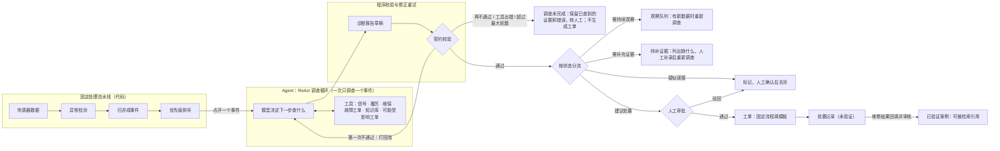
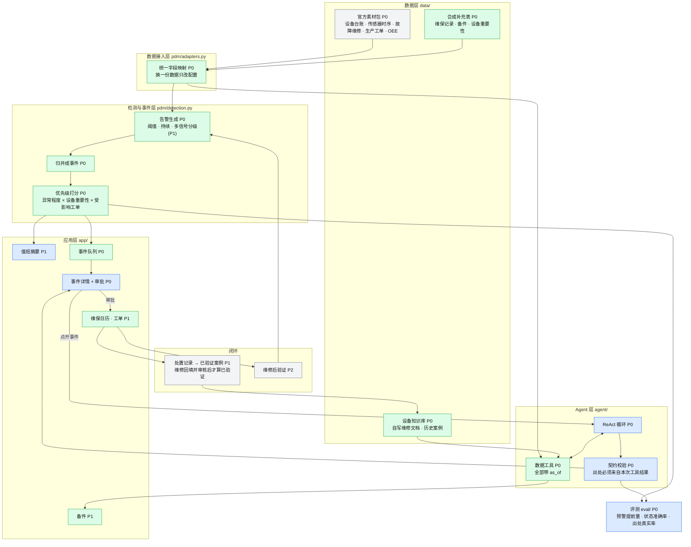

# PdM Agent · 项目规格 v2（提案，10-30；10-31 按审阅意见收口实施边界）

> 由 `DECISIONS.md` 汇总而来；每条后面括号里是对应的调研或决定编号。标 **［待定］** 的要你和 PdM 同事拍板。v1（报警诊断助手）见 git 历史。

## 一句话

**PdM Agent：设备告警处理工作台。**把重复的告警整理成设备事件并排好先后，agent 逐个去查维保、履历、信号和知识库，给出带出处的处置建议，人审批后生成工单，处理结果再沉淀成新案例。

## 用户和痛点

- **用户**：现场设备工程师，多为本科或大专。他们的原话是：系统应该**减少**工作量，而不是增加工作量；最看重的是**准不准**。
  - 界面上结论先行：一句话结论 + 建议动作放最上面，agent 调查过程默认折叠，术语尽量用白话；
  - “准”要有数：评测结果直接展示在页面上，不准的地方标“疑似”或“需补充证据”，不硬下结论。
- **痛点**（以下规模数字来自此前对 Azure PdM 的分析，只作为行业背景，路演不当作本作品的结果引用）：
  - **告警太多、重复太多**：100 台设备一年，逐小时告警 129,287 次，其实只是 3,559 个事件；
  - **误报太多**：72 小时内真故障约 20%；
  - **系统都有，但没人有空看**：维保、履历、信号、手册往往已经集成在 PdM 系统里，但查证还是靠人一页页点；客户忙别的重要事情时，就很少打开系统。线索是有的（比如保养后 7 天内的告警几乎都是误报），只是没人逐条去查。瓶颈不是数据分散，而是**人的注意力**；
  - **处理记录没人认真填**，经验沉淀不下来。［待定：用你的现场经验确认这一条，只讲经验，不展示公司系统］

## 功能结构（按用户能看到、能用的功能拆）

叶子节点是**演示时能指给评委看的功能**；循环、契约、数据接入这类内部实现不在这里，放在下一节“技术架构”。标注：状态 / 优先级 / 负责人 / 实现方式。

> 状态按本节点完整描述验收；底层代码完成、离线脚本通过或部分能力可用，均不等于整个节点完成。详细验证记录见 TASK.md。
> `[ ]` 未实现　`[/]` 部分实现或尚未完成验证（↳ 注明差什么）　`[x]` 已实现并完成该功能的验收　`[?]` 有阻塞（注明原因）。
> 每个切片验收后同步一次；节点打勾后删掉它的 ↳ 临时说明。功能树回答“哪些能力已经能用”，TASK.md 回答“现在做什么、卡在哪里”。（最近同步：切片 1 + 夜间切片 2 代码部分，10-31）

```text
PdM Agent（设备告警处理工作台）
├── 1 设备监测
│   ├── [/] 1.1 设备台账 ............ 产线、关键部件、维保周期、重要性            P0 / 同事 / 代码
│   │         ↳ 台账已读入，agent 可查；重要性待同事数据，页面待做
│   ├── [/] 1.2 诊断值可视化 ........ 每台设备的异常分趋势、当前状态灯            P0 / 同事 / 代码
│   │         ↳ 设备总览页已有：状态灯（告警中 / 数据不足 / 关注 / 正常，当前值缺失不拿旧值顶替）和最近 72 小时振动偏离小图；待人工审核
│   └── [/] 1.3 信号与特征可视化 .... 6 个量的原始曲线、滚动均值和偏离、事件区间高亮  P0 / 同事 / 代码
│             ↳ 详情页已有曲线（只画到当前时刻）、振动 6 小时均值、事件区间高亮；偏离（z）曲线待做
├── 2 异常检测与告警
│   ├── [/] 2.1 异常检测 ............ 振动持续偏离（滚动统计）+ 温度 / 电流的疑似传感器尖峰  P0 / 同事 / 代码
│   │         ↳ 规则和单测已完成（16/16 覆盖，参数在这 16 次上调定）；待同事对照曲线复核
│   ├── [/] 2.2 告警归并成事件 ...... 连续告警合成一个设备事件，原始告警可查      P0 / 同事 / 代码
│   │         ↳ 事件表已上队列页（按当前时刻：告警小时 → 事件数）；逐小时原始告警的查看待做
│   ├── [/] 2.3 事件优先级排序 ...... 异常程度 × 设备重要性 × 受影响生产工单，依据摊开  P0 / 同事 / 代码
│   │         ↳ 队列页已排序、分项摊开；重要性待同事数据（现按 1），订单可知时间未知暂不计分；待人工审核
│   └── [ ] 2.4 分级告警 ............ 关注 / 预警 / 告警三级                      P1 / 同事 / 代码
├── 3 智能诊断（agent）
│   ├── [/] 3.1 证据查询 ............ 信号、异常履历、维保、故障工单、知识库、受影响工单  P0 / 你（工具实现：同事）/ agent
│   │         ↳ 9 个工具已接入 agent（按 as_of 过滤）；履历、受影响工单用官方数据已可用；维保、知识库、备件代码就绪，待同事数据
│   ├── [/] 3.2 根因分析 ............ 疑似部位 + 依据 + 排除了哪些               P0 / 你 / agent
│   │         ↳ 调查链路已接通（脚本模型）；真实模型及人工核对待做
│   ├── [/] 3.3 误报判别 ............ 疑似传感器尖峰等判为疑似误报，写明理由     P0 / 你 / agent
│   │         ↳ 脚本场景已跑；真实模型判断待验
│   ├── [/] 3.4 诊断报告生成 ........ 一句话结论 + 证据 + 待确认事项             P0 / 你 / agent
│   │         ↳ 报告与契约已实现，详情页结论先行、调查过程（含查询目的）可展开；真实模型待验
│   └── [/] 3.5 证据追溯 ............ 每条结论点开看出处；删掉证据后结论跟着变    P0 / 你 / 代码
│             ↳ 点开出处看原文已实现（读调查时的快照）；删证据重查待做（切片 2）
├── 4 维护决策与工单
│   ├── [/] 4.1 处置建议 ............ 措施 + 风险等级；临近计划保养时建议合并      P0 / 你 / agent
│   │         ↳ 措施和风险等级已进契约；真实模型待验，合并保养待维保数据
│   ├── [/] 4.2 人工审批 ............ 通过 / 驳回 / 修改                           P0 / 你 / 代码
│   │         ↳ 通过 / 驳回 / 改措施（须重新确认风险）、误报确认关闭已实现，报告过期不可审批、只出一单；待人工审核
│   ├── [/] 4.3 工单生成 ............ 故障描述、影响范围、建议措施、所需备件      P0 / 你 / 代码（固定模板，D27）
│   │         ↳ 固定模板已实现，字段全部来自已校验报告和代码查询（备件按疑似部位查，备件表到之前写“待补”）；待人工审核
│   ├── [ ] 4.4 维保日历 ............ 上次 / 下次保养，临期和超期                 P1 / 同事 / 代码
│   │         ↳ 后端工具 get_maintenance 已有（含下次计划日期）；页面待做，数据待同事
│   ├── [ ] 4.5 备件查询 ............ 库存、安全库存、采购周期                     P1 / 同事 / 代码
│   │         ↳ 后端工具 check_spare_parts 已有（低于安全库存标出）；页面待做，数据待同事
│   └── [ ] 4.6 闭环跟进 ............ 处置结果分类（真实故障 / 疑似误报 / 传感器尖峰 / 待观察）；工单是否关闭、关闭后信号是否恢复  P1 / 共同 / 代码
├── 5 值班摘要
│   ├── [ ] 5.1 定时推送 ............ 每天固定时间生成：今天必须处理的 2–3 件事，各一句理由  P1 / 你 / agent
│   └── [ ] 5.2 按人定制 ............ 按用户订阅的产线 / 设备过滤                  P1 / 你 / 代码
└── 6 知识与记忆
    ├── [ ] 6.1 设备维修文档 ........ 按设备类型写，标明自编                       P0 / 同事 / 文档
    │         ↳ 模板已定；检索代码（BM25 + 中文分词）就绪；文档里的数字只能连同单位照抄进证据（契约检查），待同事编写文档
    ├── [ ] 6.2 历史故障案例 ........ 初始若干条                                   P0 / 同事 / 文档
    │         ↳ 模板已定；每个案例文件是一份快照，updated_at ≤ 调查时点才可见；未验证案例不能用来肯定或排除根因（契约检查），待同事编写
    ├── [ ] 6.3 处置记录与案例 ...... 审批后存为处置记录（未验证）；维修结果回填并审核后才成为可检索的已验证案例  P1 / 共同 / 代码
    └── [ ] 6.4 设备档案 ............ 该设备的告警和故障规律、上次怎么处理的      P1 / 同事 / 代码

后续计划（路演单独一页，不在 Demo 里做）：按使用习惯自动定制推送、记住每位工程师最近关心的问题、结合人员技能和班次智能派工、维修后自动验证、趋势外推。
```

阶段划分：先做完所有 P0，形成“监测 → 告警 → 诊断 → 审批出工单”的完整一条线，再加 P1。P2（维修后验证、趋势外推）有时间再说。

## 每个功能怎么实现：代码 / 固定流程 / agent

判断标准：**下一步由代码里预先写好的规则决定，还是由模型根据证据决定？**前者是代码或固定流程，后者才是 agent。固定流程同样可以根据查询结果分支、循环、重试，“要看上一步结果”本身不等于 agent（参照 Anthropic《Building effective agents》）。数字必须准的一律由代码算。

| 实现方式 | 特点 | 功能树里的功能 |
|---|---|---|
| **纯代码**（不调模型） | 结果确定，可单元测试 | 1.1–1.3 监测和可视化、2.1–2.4 检测归并排序、3.5 证据追溯（契约校验）、4.2 审批、4.3 工单生成（固定模板，字段来自已校验报告，D27）、4.4 维保日历、4.5 备件、4.6 闭环状态流转、5.2 按人过滤、6.4 设备档案汇总 |
| **固定流程**（步骤和分支规则写在代码里，模型只在固定位置填内容） | 好测、稳定、成本低；模型输出仍要评测 | 5.1 值班摘要（取前几个事件 → 模型写摘要）、6.3 案例入库（审批通过 → 模型按案例格式总结 → 存库） |
| **agent**（模型自己决定下一步查什么） | 灵活，但要靠契约兜底 | 3.1–3.4 调查、根因、误报判别、诊断报告；4.1 处置建议 |

“诊断报告”是两者的组合：**查什么、查几步由 agent 决定；最后交出来的报告必须符合固定模板**（输出契约），不符合就打回重写。

两点边界：

- **契约只能检查形式**：出处 id 存在且来自本次工具结果、状态和字段合法。出处是否真的支持结论、根因是否正确，契约查不出来，要靠人工审批和评测。
- **固定流程里的模型输出也要评测**：摘要可能漏掉最要紧的事件，工单可能填错字段，案例总结可能把“疑似”写成“已确认”。

**harness** 是包在这些功能外面的基础设施，固定流程和 agent 都在里面运行：工具（带 `as_of`）、循环控制（最大轮数、出错回传）、输出契约、人工审批这道关、记忆（异常履历、案例库、设备档案）、定时触发（值班摘要）、调查过程日志（详情页里展示的那份）。

### 对照 workflow 模式（参照 CS329Z 里 STORM 的标注方式）

整体是固定的工作流骨架，只有“调查”这一个节点是 agent。每个状态都有去向，失败也有出口：



| 模式 | 在我们系统里 | 说明 |
|---|---|---|
| 固定处理流水线 | 检测 → 归并 → 排序 | 全是代码，不调用模型。不叫 Prompt Chaining，那个特指多次模型调用前后衔接 |
| Prompt Chaining | 工单 → 处置记录 → 案例总结 | 固定步骤里的几次模型调用 |
| Routing | 按诊断状态分流到五个去向 | 分流规则是代码 |
| 程序校验与修正重试 | 契约校验不通过就打回改一次，再不过转人工 | 可以类比 Evaluator–Optimizer，但评估方是代码，只查形式 |
| Agent | 只在调查环节 | 相当于 STORM 里“作者 ↔ 专家”的问答循环 |
| 人工审批 | 处置前必须经过 | 工业场景必须有 |
| Parallelization | **第一版不做**，列为后续优化 | 以后同时调查多个事件时，每个事件要有独立的上下文和证据集合，防止串用出处 |
| Orchestrator-Workers | 不用 | 只有一类数据、两个人开发，多 agent 只会增加调试成本（R5） |

## 技术架构（D4，数据怎么流、模块谁负责）

网页工作台，agent 嵌在里面。复合 AI 系统，“大小模型协同”：代码负责检测、归并、打分和校验，agent 负责查证和写建议，人负责审批。

颜色表示负责人（蓝：你，绿：PdM 同事，灰：共同），方框里标的是优先级。



对应的代码目录：

```text
sukesong2026/
├── data/official/      官方素材包（入库前确认能否随作品提交）
├── data/synthetic/     合成补充表（维保、备件、重要性）       ← 同事
├── data/kb/            知识文档 + 历史案例                    ← 同事写文档，你定格式
├── pdm/adapters.py     统一字段映射                           ← 你
├── pdm/detection.py    告警、归并、打分                       ← 你
├── pdm/tools.py        数据工具（按 as_of 过滤）               ← 你
├── agent/              循环、提示词、契约                     ← 你
├── app/                Streamlit 页面                         ← 队列 / 维保 / 备件：同事；摘要 / 详情：你
└── eval/               题集和评测                             ← 你
```

## 页面（D14）

1. **事件队列**：事件列表，按优先级排序；每个事件显示分数构成（持续时长、峰值、异常信号数、近期是否保养、设备重要性）和 agent 的分诊标签。顶部一行统计：告警数 → 事件数 → 疑似误报数。
2. **事件详情**（主演示页）：
   - 左：事件信息 + 异常信号前后的趋势曲线；
   - 中：agent 调查过程（每步调了什么工具、查到什么）；
   - 右：处置建议（状态、疑似部件、证据出处、建议措施和风险等级、备件、待确认事项）；
   - 按钮：重新调查、删掉某条证据后重新调查、审批 / 驳回。
3. **维保日历和工单**：按设备、部件显示上次保养和下次计划保养；工单列表（审批生成的那些）。
4. **备件**：部件对应的备件、库存、采购周期（只读）。

不做：系统管理、统计大屏（D13）。界面用浅色简洁布局，不沿用公司系统风格（D15）。

## 功能和优先级（对应 P5 三模块）

| 优先级 | 功能 | 模块 | 实现方式 |
|---|---|---|---|
| **P0** | 告警生成 + 归并成事件 | ② 分级告警 | 代码 |
| P0 | 事件优先级打分，依据摊开 | ③ 维护优先级 | 代码 |
| P0 | 信号趋势可视化 | ① 信号可视化 | 代码 |
| P0 | agent 调查：查信号、报错、保养、故障历史、知识库 → 疑似部件和证据 | ② 根因分析 | **agent** |
| P0 | 处置建议 + 契约校验 + 审批 → 工单 | ③ 工单生成 | **agent** + 代码 |
| P0 | 题集 + 评测 | — | 代码 |
| **P1** | **值班摘要（主动推送）**：agent 定时把新事件过一遍，生成一页摘要：今天必须处理的前 3 个（带理由）、已标疑似误报的 N 个、近期到期的保养。人不用打开系统逐条点，看摘要、点确认即可 | 闭环 | agent + 代码 |
| P1 | 联动维保日历：同部件计划保养在 N 天内［待定 N］就建议提前合并处理 | ③ 维护决策 | agent + 代码 |
| P1 | 查备件库存，缺货时提示采购周期 | ③ 备件需求 | 代码 |
| P1 | 告警分级（阈值 / 持续 / 多信号同时异常） | ② 分级告警 | 代码 |
| P1 | 处置记录与案例：审批后存为未验证记录，维修回填并审核后成为已验证案例（D16 ①） | 闭环 | 代码 + 固定流程 |
| P1 | 删证据重查（演示“结论跟着证据走”） | — | 页面 |
| **P2** | 维修后自动验证（D16 ②） | 闭环 | 代码 |
| P2 | 趋势预警：健康指标外推（不做寿命预测模型，D10） | ② | 代码 |
| P2 | XJTU 单轴承振动深度诊断样例（频谱 / 包络谱）［待定］ | ① ② | 代码 + agent |

## agent

**一个循环，不做多 agent**（R5）。所有数据工具都带 `as_of`（调查时点），只返回这个时刻之前发生或创建的数据（D7）。`as_of` 由程序在执行工具时统一绑定，不出现在给模型的工具说明里，模型填了也会被丢弃（D24）；唯一例外是**在这之前就已排好的未来计划**（如下次保养日期），可以读。

过滤看的是**信息当时是否已经可知**，不是事情发生的时间。例如故障维修工单里的原因和处理方式是修完才填的：官方数据没有填写时间，按“故障发生时间 + 停机时长”作为最早可见时间，早于这个时刻调查时看不到这张工单。

| 工具 | 返回 | 出处 id 示例 |
|---|---|---|
| `get_event(event_id, as_of)` | 设备、开始时间、截至 as_of 的持续时长、主导信号、峰值 | `EV-IM011-0920T23`（设备短码 + 开始时刻） |
| `get_equipment(equipment_id)` | 设备名称、产线、投产日期、维保周期、关键部件、重要性 | `EQ-CNC-001` |
| `signal_summary(equipment_id, signal, as_of, hours=24)` | 窗口均值、基线、偏离（σ）、趋势方向、缺失小时数；`signal` 只开放振动 / 温度 / 电流（转速、负载率、湿度是噪声，不用来下结论） | `SIG-CNC001-vib-24h-0911T14` |
| `get_alarm_history(equipment_id, as_of, days=7)` | 异常履历（本系统生成的告警和事件） | `EV-CNC001-0910T10` |
| `get_maintenance(equipment_id, as_of, days=60)` | as_of 之前的保养记录 + 已排好的下次计划日期（官方只给了维保周期，记录是合成的） | `MT-CNC001-0901` |
| `get_failure_history(equipment_id, as_of)` | 故障维修工单（现象、原因、停机时长、费用、处理方式） | `WO-2026-1000` |
| `search_knowledge(query, as_of)` | 知识文档 + as_of 之前已存在的案例片段；每条标“已验证 / 未验证”，未验证的不能作为根因依据 | `KB-comp2-01`、`CASE-0003` |
| `check_spare_parts(component)` | 备件编号、库存、安全库存、采购周期 | `SP-主轴轴承` |
| `get_affected_orders(line, as_of)` | **可能受影响**的待产工单：可在该产线生产的订单的客户等级、交期。官方只给了“可产线”，不是实际排产，结论只能写“可能” | `WO-2026-3002` |

**输出契约**（代码校验）：

- 状态四选一：**疑似误报 / 需持续观察 / 需补充证据 / 建议处置（可提交审批）**；另有一个只能由程序设置的“调查未完成”（工具出错、超过最大轮数、二次校验不通过），去向见上方流程图；
- 疑似部件只能写“疑似”，按可能性排序，写出排除了哪些；
- 每条证据都要有出处 id，且必须是本次工具返回过的；
- 建议措施带风险等级：加强监测、提前保养为低风险；停机检修为高风险，必须人工审批；
- 数字只能来自工具结果，模型不自己算：契约先查结构，再按出处核对测量值（只认数值字段、保留正负号，日期和编号不能作证，D26）。

## 数据（D9，10-30 改）

- **主数据：官方素材包**（R6，仿真数据，路演须注明“脱敏仿真数据，方案可迁移至真实 MES/SCADA/QMS”）。
  - 设备台账：8 台设备，分别在 8 条产线（加工中心、注塑机、装配机器人、AGV、回流焊炉）；
  - 传感器时序：2026-09 整月每小时 6 个量（振动 RMS、温度、电流、转速、负载率、湿度），含噪声、缺失值和尖峰；
  - 故障维修记录：16 张工单；
  - 生产工单和 OEE：生产工单只有“可产线”，没有实际排产，影响范围只能说“可能受影响”（要做确定的影响范围，需补一张明确标注的合成排产表）。
- **合成补充**（明确标注）：维保记录（按台账的维保周期推出）、备件库存和采购周期（按台账的关键部件，可参考官方仓储库存表）、设备重要性、设备维修知识文档 10–20 篇（官方文档只有人力、品质、供应链、物流四份制度，没有设备类，D11）。
- 不用 Azure 和 XJTU（10-30 晚定）：两个人只维护一份数据。

## 评测

- **题集**：16 次故障对应的事件 + 若干疑似传感器尖峰 + 若干证据不足。尖峰是**待判别对象**，数据里没有“误报”标签；评测时用“72 小时内没有故障”作替代标签，并在结果里写明；之后 72 小时观察期不完整的事件单列“随访不足”，不算负例（当前尖峰 21 个＝有故障 2 + 无故障 18 + 随访不足 1）。
- **指标**：
  - **预警提前量**：故障发生前多少小时出现事件（官方数据可测）；规则（振动 6 小时均值高于“之前最近 168 个未告警小时”的基线 2σ，相隔 ≤12 小时归并，D23）**是在这 16 次故障上调定的**，覆盖率随基线取法在 15/16 到 16/16 之间（当前取法 16/16，14 个事件，提前量中位数约 30 小时）；路演照实说“换到真实设备需要重新标定”，不说“已验证”。`eval/detect_check.py` 复算并打印口径；**检测评测和 agent 评测分开报**，检测效果好不代表 agent 诊断好；
  - 状态判断准确率；
  - 根因准不准**无法在官方数据上验证**（故障原因是随机生成的，见 R6），路演照实说，只展示依据和排除过程；
  - 出处真实率（目标 100%）；
  - 告警到事件的压缩比；
  - 排序后前 N 个事件里真故障的比例；
  - 审批页统计采纳率；
  - **固定流程输出检查**：工单必填字段齐全、摘要没漏掉优先级最高的事件、案例总结没有把“疑似”写成“确认”。

## 演示剧本（3 分钟，基于官方数据，具体事件开发时挑）

1. 值班摘要：一个月 8 台设备的告警 → 若干事件 → 今天只需处理这 2–3 个，各一句理由。
2. 点开一个持续升高的事件（例如装配机器人振动和温度连续 20 小时上升）：agent 查信号、台账关键部件、故障历史和知识库，给出疑似部位和依据；查到可在这条产线生产的待产订单里有战略客户、下周交期，标为“可能受影响”并提高优先级；同部件计划保养就在几天后，建议提前合并处理；备件有库存。
3. 点开一个疑似传感器尖峰（温度单点）：只有 1 小时、单个信号、振动不变，agent 判为疑似误报，交人确认。
4. 删掉一条证据，结论变成“需补充证据”。
5. 审批 → 工单 → 处置记录；回填维修结果并审核后成为已验证案例；再打开另一台同类设备的相似事件，agent 引用这条案例。
6. 最后一页：评测数字（16 次故障提前预警了几次、平均提前多少小时、误报多少）。

## 不做

整套平台、数据采集和设备接入、模型训练、寿命预测模型、多 agent、自动执行维修动作、系统管理、品质联动（D12）、统计大屏。

## 分工和同步点（D8，［待定］）

**原则：主链路的代码由你来写**（你这边有 Claude Code 和 GPT，模型更强）；同事负责领域内容、合成数据和人工核查，这些靠 PdM 现场经验，模型替代不了。两人之间通过**固定格式的数据文件**对接，同事不用改代码。

| 你（代码主链路） | PdM 同事（领域内容 + 核查） |
|---|---|
| 数据接入、异常检测、归并、排序；全部工具和 `as_of` 过滤；agent 循环、提示词、契约；事件队列和事件详情页、审批和工单；评测脚本（`detect_check.py` 和题集评测）；PPT、讲稿、兜底视频 | 设备维修知识文档 10–20 篇（按设备类型，标明自编）；合成补充表：维保记录、备件、设备重要性（按你给的表头填 CSV）；初始历史案例；从数据里挑演示事件并标注“应该得出什么结论”（就是题集）；人工核查 agent 输出的引用、数字、结论是否对得上；维保日历和备件两个只读页面（P1，时间允许再做） |

表头和文件格式由你在切片 0 开始前定好发给同事。

**实施方式：纵向切片，不按模块横着做。**每一刀都从数据一路打通到页面，哪怕每层都很薄；不要先把可视化做完再做检测、再做 agent。这样任何时候停下来，手里都有一个能演示的东西。

| 切片 | 时间 | 打通什么（功能树编号） | 完成标准 |
|---|---|---|---|
| 0 | 尽快 | 数据清洗 → 2.1 / 2.2 出事件表；agent 用 3 个工具（事件、信号、历史维修工单）调查 1 个事件 → 3.2 / 3.4 | 见下方“切片 0 验收” |
| 1 | 10/31 12:00 | 1.3 曲线 + 2.3 事件队列 + 3.5 详情页 + 4.2 / 4.3 审批出工单 | 网页上从队列点进事件、看到诊断、点审批生成工单 |
| 2 | 10/31 18:00 | 补工具：维保、备件、受影响工单、知识库 → 3.1 完整、3.3 误报判别、4.1 处置建议、删证据重查 | 演示剧本 2–4 步能走通 |
| 3 | 10/31 24:00 | P1：5 值班摘要、4.4 维保日历、4.5 备件页、6.3 案例入库；题集评测出数 | 演示剧本全部走通，评测数字上页面 |
| 冻结 | 11/1 09:00 | 只修 bug；录兜底视频、写 README 和项目介绍、提交 | — |

**切片 0 验收**（“事件”指从官方仿真数据计算出的事件；契约通过不等于诊断正确）：

1. 从官方仿真数据实际算出一个事件；
2. 用真实模型调用事件、信号、历史维修三个工具完成调查；
3. 输出通过契约，并由人逐条核对引用、数字和结论是否对得上；
4. 至少验证一次“证据不足”或“工具失败”：不编答案，不生成正式工单。

第一版一次只调查一个事件，不做并行调查。切片 0 里两人并行开发：同事做数据清洗和事件表，你先用假数据写 agent 循环和契约，按工具签名对接。

## 每个切片的人工审核点

比赛做的是 Demo，人工只审**会在演示中出丑或误导评委**的地方；代码写法交给 GPT 审，规则交给单元测试。每个切片控制在 10–15 分钟内审完。

| 切片 | 审什么 | 谁审 |
|---|---|---|
| 0 | ① 事件表：阈值、基线、归并规则算出来的事件，和你肉眼看曲线的判断是否一致；② 一份 agent 诊断：每条引用点开对照原始数据，数字是否一致、结论是否超出证据；③ 失败路径：证据不足或工具出错时没有编答案、没有生成工单；④ `as_of` 测试通过 | 你；① 请同事一起看 |
| 1 | ① 详情页最上面的结论，工程师一眼能不能看懂、知道下一步做什么；② 审批后生成的工单字段对不对；③ 曲线上的事件区间和事件表对得上 | 同事看 ①，你看 ②③ |
| 2 | ① 误报判别那条尖峰的理由在设备上站不站得住；② 删掉证据后结论确实变了，而且变得合理；③ “可能受影响工单”的措辞没有说过头；④ 合并保养建议的日期对不对 | 同事看 ①④，你看 ②③ |
| 3 | ① 值班摘要没漏掉优先级最高的事件；② 评测数字能复算、口径写清楚；③ 按演示剧本完整走一遍并计时（3 分钟内）；④ 案例的“已验证 / 未验证”标注正确 | 你 |
| 冻结前 | 路演口径：注明脱敏仿真数据；分清已实现和后续计划；不说“根因准确率”这类数据无法验证的话 | 你 |

## 验证分工（三层，各查各的）

| 谁 | 查什么 | 怎么查 |
|---|---|---|
| **GPT（代码审查）** | 每个切片的 diff，重点查：`as_of` 有没有漏过滤、模型有没有自己算数字、契约能不能被绕过、“调查未完成”会不会仍然生成工单、出处 id 是否只来自本次工具结果 | 按切片审 diff，把上面这张清单一起发给它，不要一次审整个仓库 |
| **自动检查（少量单元测试）** | 端到端“看起来对”但其实错了的情况：① 用故障前的 `as_of` 调工具，确认拿不到那张维修工单；② 编一个不存在的出处 id，确认契约拒绝；③ 工具报错或超轮数，确认状态是“调查未完成”且没有工单；④ 检测结果锁定（当前口径 14 个事件、覆盖 16/16），改参数时测试会提醒；⑤ 只用截至 `as_of` 的数据重算，事件表和全量结果截断后一致 | 每改一次跑一次，几秒钟 |
| **你（端到端 + 读 trace）** | 演示剧本能不能走通；挑 2–3 个事件读 agent 的调查过程，看哪一步查错、哪个结论没有依据。关键事件用真实模型多跑几次，看结论稳不稳（pass^k） | 每个切片结束跑一遍 |
| **PdM 同事（领域核查）** | 结论在设备上说不说得通：部位、措施、风险等级 | 对照他标注的题集逐条看 |

## 未定

- 重点放排序还是调查：现在的提案是两者都做，深度放在调查。
- 素材包说明里提到的配套文档《AI+智能制造赛道_场景素材包.md》不在文件夹里，去群里要一份。
- 官方数据能否随作品提交到代码仓库（不公开的话应该没问题，问一句）。
- 合并保养的天数 N；高风险措施的范围。
- XJTU 频域样例做不做（P2）。
- 领导确认保密边界。
